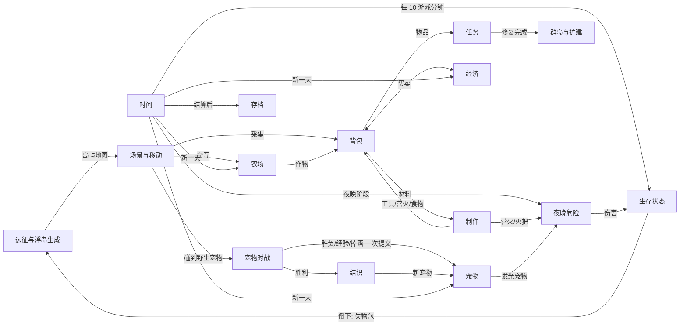

# 游戏开工图

版本：0.2｜日期：2026-11-08｜状态：方向已确认，系统细节为建议，需试玩验证

标注说明：【已确认】负责人明确说过；【计划已批准】负责人批准过的方案；【建议】AI 提出、尚未单独确认；【待验证】需要试玩判断。

v0.2 变更：加入冒险探索（饥荒式远征浮岛、中度生存、昼夜危险、制作），玩法定位改为 **饥荒 + 浮岛 + 星露谷 + 宝可梦**。变更明细见第 8 节。

## 1. 玩法骨架

**玩家身份**：回到云海群岛的年轻人。在家园浮岛过日子，带着宠物伙伴乘飞艇去未知的远征浮岛冒险，把材料和新伙伴带回家，一步步扩建家园、修复群岛。

**四个参考各借鉴什么**【已确认方向，细节为建议】（只借玩法，不照搬画面和内容）
| 参考 | 借鉴 | 在我们游戏里的样子 |
|---|---|---|
| 饥荒 | 采集、制作、饱食度、昼夜危险、倒下掉落 | 远征浮岛上采集材料、做工具和营火；夜里起雾、雾怪出没，靠光驱散；饥饿会掉生命；倒下后物品留在原地 |
| 浮岛类 | 多座浮岛，逐步解锁和扩建 | 家园浮岛买地扩建；飞艇去随机生成的远征岛；修桥连通主岛 |
| 星露谷 | 种田、居民好感、每日循环 | 家园浮岛是安全区：种田、照顾宠物、和小镇居民来往 |
| 宝可梦 | 收集宠物、属性克制、回合对战、成长 | 6 种宠物、四属性、3v3 回合制对战、结识野生宠物 |

**两种节奏交替**
- **家园日**（安全、治愈）：收菜、喂宠物、派宠物打工、去小镇交任务、布置家园、睡觉存档。
- **远征**（紧张、收获大）：带补给乘飞艇出发 → 随机浮岛上采集、制作、遇到野生宠物对战结识、找宝箱 → 天黑前回飞艇；或者点营火扎营过夜，熬过雾怪，第二天继续深入。

**核心循环**
```
远征采集材料、结识宠物 ─┐
家园种田、宠物打工产出 ─┼→ 制作工具和补给 / 出售换四叶草 / 交任务换好感
                         └→ 扩建家园岛、修复设施、升级飞艇
→ 能去更远、更危险的远征岛（新地貌、新宠物、稀有材料）→ 再出发
```

**期望感受**：家园的治愈和远征的紧张互相衬托；宠物是陪你过日子、也陪你冒险的伙伴。

**体验假设**【待验证】
- H1：宠物同时是战斗、打工、探索伙伴，玩家会更在意每一只宠物。
- H2：回合制对战 + 「结识」而非「抓捕」，能保持治愈调性，同时给探索目标感。
- H3：一天约 10–15 分钟现实时间，适合手游碎片时间，玩家愿意连续玩 3 天以上。
- H4（新）：远征的紧张感（饥饿、天黑、雾怪）能让回到家园的治愈感更强，而不是让休闲玩家劝退。
- H5（新）：倒下后物品留在原地、可以回去捡，会制造「回去拿回来」的动力，而不是挫败感。

最便宜的验证方式：M1 只做「白天远征一座随机岛 → 采集制作 → 对战结识 → 天黑前回来」；M2 再加夜晚和倒下。各找 3 人不讲解试玩，观察是否主动再出发、能否说出属性克制、倒下后是否愿意回去捡。

## 2. 需求表

| ID | 需求 | 来源 | 分类 | 首版 |
|---|---|---|---|---|
| R01 | 横屏手游 | 已确认 | 技术 | 必须 |
| R02 | 美术沿用风格示例：治愈、森林小岛、木框奶油色 UI | 已确认 | 表现 | 必须（占位图先行） |
| R03 | 玩法包含探索 + 宠物 + 战斗 | 已确认 | 系统 | 必须 |
| R04 | 融合星露谷（种田、好感、季节）和浮岛类（岛屿解锁/扩建） | 已确认 | 系统 | 必须 |
| R05 | 宠物是核心卖点 | 已确认 | 系统 | 必须 |
| R06 | 玩法参考 Steam 游戏，但不照搬 | 已确认 | 策划原则 | — |
| R07 | 2.5D 固定 3/4 俯视角，手绘插画风，不做真 3D | 已确认（2026-11-08 再次确认，未采用实时 3D 方案） | 技术/表现 | 必须 |
| R08 | 宠物兼具生活技能（打工）和战斗技能 | 计划已批准 | 系统 | 必须 |
| R09 | 宠物对战：回合制 3 只出战，森/水/火/光属性克制；**宠物对战输了不惩罚** | 计划已批准；2026-11-08 修改（原「输了不惩罚」只适用于宠物对战，玩家本人倒下见 R19） | 系统 | 必须 |
| R10 | 用食物和好感「结识」野生宠物，而不是抓捕 | 计划已批准 | 系统 | 必须 |
| R11 | 种田与昼夜、天数循环 | 计划已批准 | 系统 | 必须 |
| R12 | 小镇居民好感、送礼、简单任务；商店 | 计划已批准 | 系统/内容 | 必须 |
| R13 | 扩建与修复：买地扩建家园岛、修桥解锁主岛 | 计划已批准；2026-11-08 扩展（加买地扩建） | 系统 | 首版：买地 1 次 + 修桥 1 次 |
| R14 | 家园布置 | 计划已批准 | 系统 | 简易版 |
| R15 | 本地存档 | 计划已批准 | 技术 | 必须 |
| R16 | 网页开发，后续打包手机应用 | 计划已批准 | 技术 | 首版只要手机浏览器可玩 |
| R17 | 活动大厅 / 限时活动等运营功能 | 风格示例 | 系统 | 暂不做 |
| R18 | 冒险探索：乘飞艇去远征浮岛（饥荒式） | 已确认 | 系统 | 必须 |
| R19 | 中度生存：饱食度归零持续掉生命；远征中倒下，背包大部分物品掉在原地，要回去捡 | 已确认 | 系统 | 必须 |
| R20 | 主岛（家园、小镇）手工设计；远征浮岛每次随机生成 | 已确认 | 系统/内容 | 必须（首版 1 种地貌） |
| R21 | 探索中的危险是即时的（夜晚雾怪、地面预警圈，要走位躲开）；宠物对战是回合制 | 已确认 | 系统 | 必须 |
| R22 | 采集与制作：工具、火把、营火、帐篷、熟食 | 建议（来自饥荒方向） | 系统 | 必须 |
| R23 | 昼夜与光照：夜里雾怪只怕光，营火、火把、发光宠物照明；可扎营过夜 | 建议（来自饥荒方向，参考视频 v1、v8） | 系统/表现 | 必须 |
| R24 | 宠物探索技能：照明、驮运、开路、寻宝 | 计划已批准（2026-11-08） | 系统 | 必须 |

## 3. 系统表

| ID | 系统 | 职责 | 输入 → 输出 | 状态负责方 | 首版最小实现 |
|---|---|---|---|---|---|
| S01 | 场景与移动 | 地图、碰撞、镜头、出入口、交互检测 | 摇杆/按键 → 位置、朝向、交互目标 | 场景 | 家园岛、小镇、远征岛、室内 |
| S02 | 时间与每日结算 | 时钟、天数、昼夜、睡觉结算 | 时间流逝/睡觉 → 新一天事件、昼夜阶段 | 时间系统 | 家园 24 点强制睡觉；远征可过夜 |
| S03 | 农场 | 开垦、播种、浇水、生长、收获 | 工具动作 → 地块状态、作物 | 农场 | 5 种作物 |
| S04 | 背包与物品 | 物品增减、分类、详情、使用 | 获得/消耗 → 数量 | 背包 | 20 格起，可扩展 |
| S05 | 宠物 | 队伍、跟随、好感、喂食、打工、成长、探索技能 | 喂食/派遣/经验 → 宠物状态、产出、探索效果 | 宠物 | 6 种宠物 |
| S06 | 宠物对战 | 回合流程、技能、克制、胜负 | 队伍 + 遭遇 → 胜负、经验、掉落 | 战斗（只读宠物，结束时一次提交） | 3v3 轮换出战 |
| S07 | 结识 | 战后结识野生宠物 | 胜利 + 食物 → 新宠物 | 宠物 | 喜好食物必成，其他 50% |
| S08 | 居民与对话 | 对话、好感、送礼 | 交谈/送礼 → 好感 | 居民 | 3 位居民 |
| S09 | 任务 | 任务状态、交付、奖励 | 物品/事件 → 完成、奖励 | 任务 | 约 6 个 + 主线修桥 |
| S10 | 商店与经济 | 买卖、出货箱、四叶草货币 | 买卖 → 货币、物品 | 经济 | 1 家店 + 出货箱 |
| S11 | 家园布置 | 室内摆放、移动、旋转、收回 | 家具 → 房间布局 | 家园 | 网格摆放 |
| S12 | 群岛与扩建 | 主岛连通、买地扩建、修复 | 材料/四叶草 → 解锁 | 世界 | 买地 1 次、修桥 1 次 |
| S13 | 存档 | 保存、读取、版本迁移 | 状态 → 存档 | 存档 | 安全点自动存 |
| S14 | UI 框架 | HUD、面板栈、提示、横屏缩放 | 事件 → 界面 | UI | 木框奶油色 |
| S15 | 制作（新） | 配方、材料检查、产出 | 材料 → 工具/装置/食物 | 制作 | 野外配方 + 家园工作台 |
| S16 | 生存状态（新） | 生命、饱食、倒下与失物包 | 时间/伤害/进食 → 状态、倒下事件 | 生存 | 生命 100、饱食 100 |
| S17 | 远征与浮岛生成（新） | 飞艇出发/返回、按种子生成岛屿、可达性校验、岛上变化记录 | 种子 + 地貌 → 岛屿地图 | 远征 | 1 种地貌（雾林） |
| S18 | 夜晚危险与光照（新） | 雾怪生成、预警攻击、光源范围、营火燃料 | 昼夜 + 光源 → 雾怪行为、伤害 | 夜晚 | 1 种雾怪，营火/火把/发光宠物 |



关键连接约定：
- 宠物对战开始时复制队伍数据，只改副本；结束时一次性提交经验、体力、掉落。
- 宠物对战进行中，探索时间暂停，雾怪不行动。
- 玩家倒下时，由生存系统（S16）计算失物包内容，远征系统（S17）把失物包记在那座岛的变化记录里；同一时刻只存在一个失物包。
- 每日结算顺序：出货结算 → 作物生长 → 宠物打工产出 → 刷新家园资源 → 天气 → 存档。
- 存档只在安全点写入：睡觉结算后、切换场景时、扎营点燃营火时；对战中和倒下动画中不存。

## 4. 场景职责（首版）

| 场景 | 玩家来此目的 | 关键内容 | 出口 |
|---|---|---|---|
| 家园浮岛（手工） | 种田、照顾宠物、出货、制作、出发 | 房屋、农田、出货箱、宠物小屋、工作台、飞艇码头、可购买的扩建地块 | 码头 → 远征；吊桥 → 小镇 |
| 风铃小镇（手工） | 交任务、买卖、提升好感 | 3 位居民、商店、断桥（主线修复点） | 吊桥 → 家园 |
| 远征浮岛（随机） | 采集、对战结识、找宝箱、过夜 | 着陆点（飞艇停靠）、资源点、野生宠物、宝箱、可扎营空地 | 飞艇 → 家园 |
| 家园室内 | 睡觉、布置 | 床、可摆放网格 | 门 → 家园浮岛 |

坐标约定：网格单位 48 像素；原点在地图左上角，x 向右、y 向下；角色碰撞框取脚底一小块。远征岛生成规则见 `docs/06_远征与生存.md`。

## 5. 首版范围

**必须做**：R01–R03、R05、R07–R12、R15、R16、R18–R24；S01–S10、S13–S18；家园布置简易版（S11）；买地 1 次 + 修桥 1 次（S12）。

**体验验证后再做**：第二种地貌（沙丘，参考视频 v7 的沙暴遮挡视野）、季节与节日、宠物进化、钓鱼、自动化设施（参考视频 v5）、升级三选一技能卡（参考视频 v6）、雾怪可被光属性技能击退。

**暂不做**：联网、付费、活动大厅和限时活动（R17）、真 3D、即时动作版宠物战斗。

内容数量：2 个手工外景 + 1 种随机地貌 + 1 个室内、6 种宠物、12 个技能、5 种作物、约 20 种物品、8 个制作配方、6 件家具、3 位居民、约 6 个任务、1 种雾怪。

## 6. 里程碑

| 里程碑 | 可玩结果 | 退出条件 |
|---|---|---|
| M0 技术基线 | Phaser 横屏占位场景在手机浏览器运行，摇杆可移动 | 手机尺寸模拟中能打开、移动、缩放正确 |
| M1 白天远征 | 随机远征岛 → 采集、制作工具 → 饱食消耗 → 遇野生宠物 3v3 对战 → 结识 → 天黑前回飞艇 | 胜利、失败、溜走、返回都有出口；同一种子生成同一座岛；3 人试玩记录 |
| M2 夜晚生存 | 天黑起雾 → 雾怪预警攻击 → 营火/火把/发光宠物 → 扎营过夜；倒下掉落失物包，回去能捡回 | 失物包不重复、不丢失；过夜燃料够用；3 人试玩记录 |
| M3 家园生活 | 种田、每日结算、宠物打工、出货、家园制作 | 连续玩 3 天作物和产出正确；刷新后存档正确 |
| M4 可交付首版 | 小镇任务、商店、买地扩建、修桥、家园布置、引导 | 新游戏到修好桥全流程可玩；手机实测 |

## 7. 未决策项与风险

| 项 | 影响 | 解锁动作 | 不受影响可继续的工作 |
|---|---|---|---|
| 游戏名 | 标题页、宣传 | 负责人定名 | 全部开发 |
| 美术素材来源（AI 出图 / 外包 / 自己画） | 2.5D 画面质量完全取决于出图 | 负责人决定，按 `03_素材规范.md` 出图 | 占位图开发 |
| **随机远征岛 + 2.5D 手绘的配合方式** | 手绘整张背景没法随机拼，远征岛需要能拼接的地块素材 | 采用「手绘地块 + 手绘摆件」拼接（见 `03_素材规范.md`）；M1 前确认美术能出拼接地块 | 主岛、对战、生存逻辑 |
| 中度生存会不会劝退休闲玩家（H4、H5） | 留存 | M2 试玩；可调的缓解手段：保留工具、失物包不过期、新手期倒下不掉落 | 全部开发 |
| 风格示例图是否放进公开仓库 | 美术指南是否附图 | 负责人决定；或把仓库改为私有 | 文字版美术指南 |
| 数值（伤害、饱食、价格） | 难度和节奏 | M1/M2 试玩后调整 | 系统实现（数值放数据文件） |
| Phaser 4 在中低端手机的性能（夜晚光照遮罩） | 流畅度 | M0 实机测试，M2 再测光照 | 其他开发 |

## 8. 变更记录

| 日期/版本 | 原因 | 修改项 | 影响 |
|---|---|---|---|
| 2026-11-07 / 0.1 | 立项 | 初版 | — |
| 2026-11-08 / 0.2 | 负责人要求加入冒险探索（饥荒 + 浮岛 + 星露谷 + 宝可梦），并确认中度生存、随机远征岛、2.5D 不变、混合战斗 | 新增 R18–R24、S15–S18、H4–H5；修改 R09（「输了不惩罚」只限宠物对战）、R13（加买地扩建）、R07（再次确认）；「雾语森林」固定场景改为随机远征岛的「雾林」地貌；里程碑由 4 个改为 5 个（新增 M2 夜晚生存） | 研发待办 T05、T06、T09、T10、T14 修改，新增 T19–T25；存档需记录远征岛种子和失物包；美术需要可拼接地块 |
