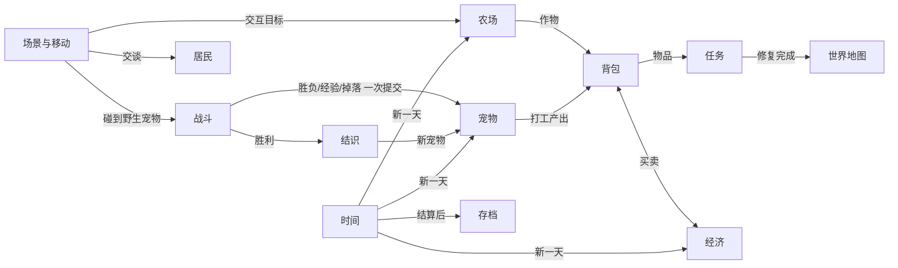

# 游戏开工图

版本：0.1｜日期：2026-11-07｜状态：方向已确认，系统细节为建议待试玩验证

标注说明：【已确认】负责人明确说过；【计划已批准】负责人批准了 2026-11-07 的方案；【建议】AI 提出、尚未单独确认；【待验证】需要试玩判断。

## 1. 玩法骨架

**玩家身份**：回到一片群岛的年轻人，带着宠物伙伴修复小岛、照顾农场。

**主要操作**：移动探索、种田（开垦/播种/浇水/收获）、照顾和派遣宠物、和居民交流交任务、带 3 只宠物回合制对战、布置家园。

**期望感受**：治愈、陪伴感；「再过一天」的期待；宠物越来越亲近、越来越能干。

**一天的流程**（一天约 10–15 分钟现实时间）【计划已批准】
早上收菜、喂宠物 → 派宠物打工 → 去小镇交任务、提升好感 → 去雾林探索对战、结识新宠物、拿稀有材料 → 回家布置 → 睡觉结算存档。

**核心循环**
```
种田/探索获得作物和材料 → 出售或交任务换四叶草（货币）和好感
→ 买种子、家具、零食；喂宠物提升好感
→ 宠物变强（战斗）和更能干（打工产出更多）
→ 去更深的区域结识新宠物、拿更多材料 → 修复小岛设施 → 解锁新岛屿
```

**体验假设**【待验证】
- H1：宠物同时是「战斗伙伴」和「打工伙伴」，会让玩家更在意每一只宠物（愿意喂养、起用不同宠物）。
- H2：轻量回合制对战 + 「结识」而非「抓捕」，能保持治愈调性，同时给探索足够的目标感。
- H3：每日循环短（10–15 分钟）适合手游碎片时间，玩家愿意连续玩 3 天以上。

最便宜的验证方式：M1 先只做「雾林探索 → 对战 → 结识」，找 3 个人不讲解直接试玩，看是否主动再打一场、能否说出属性克制。

## 2. 需求表

| ID | 需求 | 来源 | 分类 | 首版 |
|---|---|---|---|---|
| R01 | 横屏手游 | 已确认 | 技术 | 必须 |
| R02 | 美术沿用风格示例：治愈、森林小岛、木框奶油色 UI | 已确认 | 表现 | 必须（占位图先行） |
| R03 | 玩法包含探索 + 宠物 + 战斗 | 已确认 | 系统 | 必须 |
| R04 | 方向为「治愈生活 + 轻战斗」，融合星露谷（种田、好感、季节）和浮岛类（岛屿逐步解锁/扩建） | 已确认 | 系统 | 必须 |
| R05 | 宠物是核心卖点 | 已确认 | 系统 | 必须 |
| R06 | 玩法参考 Steam 游戏，但不照搬 | 已确认 | 策划原则 | — |
| R07 | 2.5D 固定 3/4 俯视角，不做真 3D | 计划已批准 | 技术/表现 | 必须 |
| R08 | 宠物兼具生活技能（打工）和战斗技能 | 计划已批准 | 系统 | 必须 |
| R09 | 回合制 3 只宠物出战，森/水/火/光属性克制，输了不惩罚 | 计划已批准 | 系统 | 必须 |
| R10 | 用食物和好感「结识」野生宠物，而不是抓捕 | 计划已批准 | 系统 | 必须 |
| R11 | 种田与昼夜、天数循环 | 计划已批准 | 系统 | 必须 |
| R12 | 小镇居民好感、送礼、简单任务；商店 | 计划已批准 | 系统/内容 | 必须 |
| R13 | 修复设施解锁新岛屿 | 计划已批准 | 系统 | 首版只做一次修复（修桥） |
| R14 | 家园布置 | 计划已批准 | 系统 | 简易版 |
| R15 | 本地存档 | 计划已批准 | 技术 | 必须 |
| R16 | 网页开发，后续打包手机应用 | 计划已批准 | 技术 | 首版只要手机浏览器可玩 |
| R17 | 活动大厅 / 限时活动等运营功能 | 风格示例 | 系统 | 暂不做（单机核心验证后再定） |

## 3. 系统表

| ID | 系统 | 职责 | 输入 → 输出 | 状态负责方 | 首版最小实现 |
|---|---|---|---|---|---|
| S01 | 场景与移动 | 地图、碰撞、镜头、出入口、交互检测 | 摇杆/按键 → 位置、朝向、交互目标 | 场景 | 农场、小镇、雾林 3 张图 |
| S02 | 时间与每日结算 | 时钟、天数、天气、睡觉结算 | 时间流逝/睡觉 → 新一天事件 | 时间系统 | 6:00–24:00，24 点强制回家 |
| S03 | 农场 | 开垦、播种、浇水、生长、收获 | 工具动作 → 地块状态、作物物品 | 农场 | 5 种作物 |
| S04 | 背包与物品 | 物品增减、分类、详情、使用 | 获得/消耗 → 数量 | 背包 | 堆叠物品，无装备 |
| S05 | 宠物 | 队伍、跟随、好感、喂食、打工、成长 | 喂食/派遣/经验 → 宠物状态、每日产出 | 宠物 | 6 种宠物 |
| S06 | 战斗 | 回合流程、技能、克制、胜负 | 队伍 + 遭遇 → 胜负、经验、掉落 | 战斗（只读宠物，结束时一次提交结果） | 3v3 轮换出战 |
| S07 | 结识 | 战后结识野生宠物 | 胜利 + 食物 → 新宠物 | 宠物 | 喜好食物必成，其他 50% |
| S08 | 居民与对话 | 对话、好感、送礼 | 交谈/送礼 → 好感 | 居民 | 3 位居民 |
| S09 | 任务 | 任务状态、交付、奖励 | 物品/事件 → 任务完成、奖励 | 任务 | 每位居民 1–2 个 + 主线修桥 |
| S10 | 商店与经济 | 买卖、出货箱、四叶草货币 | 买卖 → 货币、物品 | 经济 | 1 家店 + 出货箱 |
| S11 | 家园布置 | 室内摆放、移动、旋转、收回 | 家具物品 → 房间布局 | 家园 | 网格摆放 |
| S12 | 世界地图与岛屿 | 区域选择、锁定/修复状态 | 修复完成 → 解锁 | 世界 | 4 个区域，1 次修复 |
| S13 | 存档 | 保存、读取、版本迁移 | 状态 → 存档 | 存档 | 睡觉/切场景自动存 |
| S14 | UI 框架 | HUD、面板栈、提示、横屏缩放 | 事件 → 界面 | UI | 风格示例的木框奶油色 |



关键连接约定：
- 战斗开始时复制队伍数据，战斗中只改副本；结束时一次性提交经验、体力、掉落，防止中途退出导致重复发奖。
- 每日结算顺序固定：出货结算 → 作物生长 → 宠物打工产出 → 刷新资源与野生宠物 → 天气 → 存档。
- 存档只在安全点写入：睡觉结算后、切换场景时；战斗中不存。

## 4. 场景职责（首版）

| 场景 | 玩家来此目的 | 关键内容 | 出口 |
|---|---|---|---|
| 家园农场岛 | 种田、照顾宠物、出货、回家 | 房屋（进入家园）、农田区（有杂物需清理）、出货箱、宠物小屋、池塘 | 东侧路口 → 世界地图 |
| 风铃小镇 | 交任务、买卖、提升好感 | 3 位居民、商店、喷泉广场、南边断桥（主线修复点） | 西侧路口 → 世界地图 |
| 雾语森林 | 探索、对战、结识、采集 | 游荡的野生宠物、树枝堆/石块/浆果丛/矿石（每日刷新） | 西侧路口 → 世界地图 |
| 家园室内 | 睡觉、布置 | 床、可摆放网格 | 门 → 农场岛 |

坐标约定：网格单位 48 像素；原点在地图左上角，x 向右、y 向下；角色碰撞框取脚底一小块。具体坐标在实现任务中写入数据文件，并在本文件记录。

## 5. 首版范围

**必须做**：R01–R03、R05、R07–R12、R15、R16，S01–S10、S13、S14；家园布置简易版（S11）；修桥一次（S12/S13）。

**体验验证后再做**：季节变化与节日、更多岛屿、宠物进化、烹饪/制作、钓鱼小游戏、宠物换装。

**暂不做**：联网、付费、活动大厅和限时活动（R17）、真 3D。

内容数量：3 个外景 + 1 个室内、6 种宠物、12 个技能、5 种作物、约 12 种物品、6 件家具、3 位居民、约 6 个任务。

## 6. 里程碑

| 里程碑 | 可玩结果 | 退出条件 |
|---|---|---|
| M0 技术基线 | Phaser 横屏占位场景在手机浏览器运行，摇杆可移动 | 手机/手机尺寸模拟中能打开、移动、缩放正确 |
| M1 宠物对战 | 雾林里碰到野生宠物 → 3v3 对战 → 结识 | 胜利、失败、逃跑都有出口；3 人试玩记录 |
| M2 生活循环 | 种田、每日结算、宠物打工、出货 | 连续玩 3 天作物和产出正确；刷新后存档正确 |
| M3 可交付首版 | 小镇任务、商店、修桥、家园布置、引导 | 从新游戏到修好桥全流程可玩；手机实测 |

## 7. 未决策项与风险

| 项 | 影响 | 解锁动作 | 不受影响可继续的工作 |
|---|---|---|---|
| 游戏名 | 标题页、宣传 | 负责人定名 | 全部开发 |
| 美术素材来源（AI 出图 / 美术外包 / 自己画） | 素材替换时间、风格统一 | 负责人决定，按 `03_素材规范.md` 出图 | 占位图开发 |
| 风格示例图是否放进公开仓库 | 美术指南是否能附图 | 负责人决定；或把仓库改为私有 | 文字版美术指南 |
| 数值（伤害、经验、价格） | 难度和节奏 | M1/M2 试玩后调整 | 系统实现（数值放数据文件） |
| Phaser 4 在中低端手机的性能 | 流畅度 | M0 实机测试 | 其他开发 |
