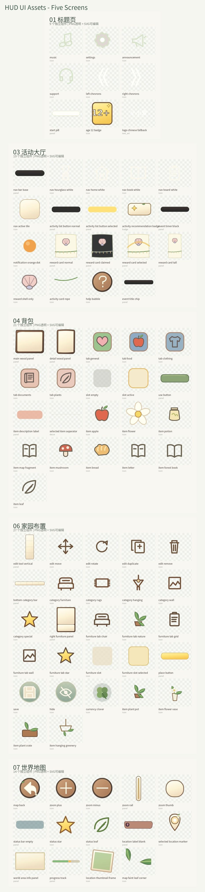

# HUD extras — five referenced screens



This package contains **97 independent HUD components** reconstructed from these five reference screenshots:
- 01 title page: 9
- 03 event hub: 19
- 04 inventory: 21
- 06 home decoration: 27
- 07 world map: 14
- shared elements: 7

### Files
- [Download 97 transparent PNG icons (compact 512px pack)](hud_v3_compact_97_png.zip)
- [Editable SVG components](SVG_Editable/)
- [Asset manifest, approximate placement and text layers](Text_And_Layouts/)

The PNG pack consists of game-ready transparent PNGs with the longest edge capped at 512 px for quick download; editable SVGs are suitable for larger-size rendering.

### Build full-size PNGs
```bash
pip install cairosvg
python convert_svg_to_png.py
```

### Source fidelity
These are **visual reconstructions**, not byte-for-byte original art exports. The five screenshots were used as visual references, but pixel-level source segmentation was not accessible in this runtime. Shapes, typography and exact placement should be compared to the source screenshot before final production.

Avoid embedding labels inside icon textures: `Text_And_Layouts/text_layers.json` separates the 40 textual labels for localization.
